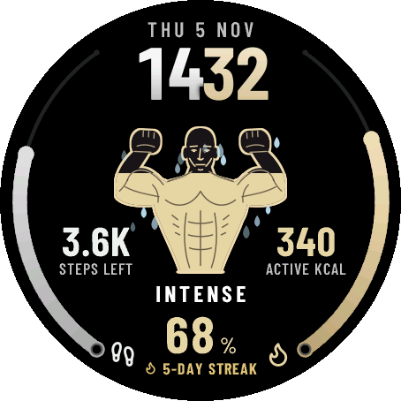
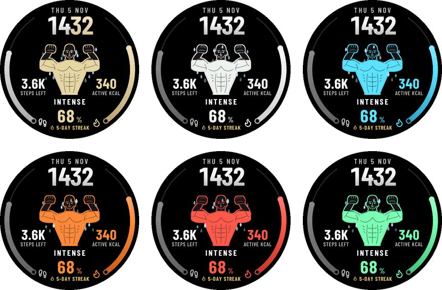
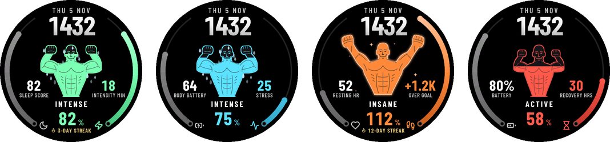
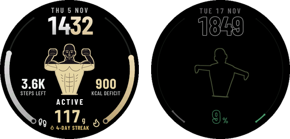

# Buff

**A Garmin watch face with a buddy who gets buff as you hit your goals.**

<p align="center"></p>

Pick what the two arcs track: steps, calories, intensity minutes, sleep score, stress, body battery and more. The
buddy in the middle follows the **right** arc. He fills up with colour as you get closer to its goal, and his pose
changes as he levels up: **FLATLINING → ACTIVE → INTENSE → INSANE**. Keep him Intense or better day after day and
you build a streak.

Everything is set on the watch itself. You don't need the phone app, an account or a server.

<p align="center"></p>

## Contents

- [What's on the face](#whats-on-the-face)
- [Which watches](#which-watches)
- [Install it (no coding)](#install-it-no-coding)
- [Customise it on the watch](#customise-it-on-the-watch)
- [Build it yourself](#build-it-yourself)
- [Make it yours: fork and change it](#make-it-yours-fork-and-change-it)
- [Working on it with Claude Code](#working-on-it-with-claude-code)
- [Optional: calorie deficit mode](#optional-calorie-deficit-mode)
- [Credits and licence](#credits-and-licence)

## What's on the face

| | |
|---|---|
| **Left arc** | whatever you pick (steps by default). Its number and label sit under the buddy's left arm. |
| **Right arc** | whatever you pick (active calories by default). The buddy follows this one. |
| **Big number** | how far the right arc is to its goal, as a percentage |
| **Level** | how the buddy's doing: **FLATLINING** under 1/6 of the goal, **ACTIVE** from 1/6, **INTENSE** from 2/3, **INSANE** at the goal. **RESTING** (asleep) means there's no reading yet. |
| **Streak** | days in a row that ended Intense or better. It's shown for steps, calories, intensity minutes and floors, which have a daily goal. |
| **Wrist down** | a dim outline version, which uses about 1% of the screen's light |

<p align="center"></p>

## Which watches

Buff is drawn for **454 × 454 AMOLED** screens and uses the on-watch face editor (Customize) that newer Garmins have.

- **Tested:** fēnix 8 (47 mm and 51 mm, including tactix 8 and quatix 8)
- **Should work, untested:** fēnix 8 Pro 47 mm, fēnix 9 47 mm, fēnix 9 Pro 47 mm, Forerunner 570 (47 mm),
  Forerunner 970, Venu 4 (45 mm), MARQ (Gen 3), D2 Mach 2, D2 Mach 2 Pro

If you try one of the untested watches, please open an issue to say how it went.

## Install it (no coding)

1. **Download** `Buff-<your watch>.prg` from the [latest release](../../releases/latest). For the fēnix 8 47 or 51 mm,
   that's `Buff-fenix847mm.prg`.
2. **Plug your watch into your computer** with its USB cable.
3. **Copy the file into the watch's `GARMIN/APPS` folder:**
   - **Windows:** the watch shows up in File Explorer (for example *fēnix 8 > Internal Storage > GARMIN > Apps*).
     Drag the file in.
   - **Mac:** Finder can't see Garmin watches (they connect over MTP). Install the free
     [OpenMTP](https://openmtp.ganeshrvel.com), open it, go to `GARMIN/APPS` on the watch side and drag the file in.
     If OpenMTP can't find the watch, quit Image Capture and Photos, unplug the watch, and plug it back in.
   - **Linux:** most file managers can open MTP devices. Otherwise, use `jmtpfs` or `go-mtpfs`.
4. **Unplug the watch.** Then on the watch: hold **MENU** (or touch and hold the watch face) > **Watch Face**, scroll
   to **Buff**, and choose **Apply**.

To update, copy the new file over the old one. To remove Buff, delete it from the Watch Face list, or delete the file
from `GARMIN/APPS`.

> Faces you install this way (called "sideloading") don't show up in the Connect IQ phone app. That's why every
> setting is on the watch.

## Customise it on the watch

Hold **MENU** (or touch and hold the face) > **Watch Face** > **Buff** > **Customize**:

- **Style:** the colour. Choose from Cream (the original), White, Ice, Ember, Coral or Mint.
- **Data:** what each arc tracks. Choose the left or right arc, then pick from the list below. You see the change
  live as you scroll.

| Choice | Shows | The arc fills to | Buddy |
|---|---|---|---|
| Steps | steps left to your goal ("3.6K STEPS LEFT"), then "+1.2K OVER GOAL" | your step goal | more is better |
| Calories | **active** calories: what you've burned above your resting rate, estimated from your Garmin profile | 500 kcal | more is better |
| Intensity Minutes | today's intensity minutes | a day's share of your weekly goal (150 → 22) | more is better |
| Floors Climbed | floors climbed today | your floors goal | more is better |
| Body Battery | Body Battery | 100 | more is better |
| Sleep Score | last night's sleep score | 100 | more is better |
| Pulse Oximeter | blood oxygen, % | 80–100 % | more is better |
| Stress | current stress | 100 | **less** is better |
| Heart Rate | **resting** heart rate (your 7-day average) | 30–100 bpm | **less** is better |
| Recovery Time | hours of recovery left | 72 h | **less** is better |
| Battery | the watch's battery | 100 % | more is better |

**Why that list?** The watch's editor only offers Garmin's own data types. So "Calories" shows active calories (you can
switch it to total calories in `source/Config.mc`), and "Heart Rate" shows resting heart rate, which suits an arc
better than your live pulse. Garmin doesn't give watch faces HRV at all, so that one isn't possible. Goals come from
your Garmin settings where Garmin has one (steps, floors, intensity minutes). The rest are in `source/Config.mc`.

## Build it yourself

You'll need:

- **The Connect IQ SDK.** Download Garmin's [SDK Manager](https://developer.garmin.com/connect-iq/sdk/), install the
  latest SDK, and download the device profile for your watch. The SDK needs Java installed.
- **A developer key**, which signs your builds. Any key works for your own watch. On macOS or Linux, `make key`
  makes one at `~/.garmin/developer_key.der`. In VS Code, run *Monkey C: Generate a Developer Key*.

Then either:

- **VS Code (Windows, Mac, Linux):** install Garmin's *Monkey C* extension, open this folder, and run
  *Monkey C: Build for Device* (pick your watch). Copy the `.prg` it makes to `GARMIN/APPS` as above.
  *Run > Run Without Debugging* opens it in the simulator.
- **Terminal (macOS, Linux):**

  ```sh
  make sim                    # start the simulator
  make run                    # build and load the face into it
  make build                  # bin/Buff.prg for the fēnix 8 (DEVICE=fr970 make build for another watch)
  make sideload               # macOS: build and copy straight to the watch (brew install libmtp)
  ```

  `make sideload` copies over USB for you. Start it *before* you plug the watch in, then plug in when it says so.

## Make it yours: fork and change it

1. Click **Fork** at the top of this page, then clone your fork:
   `git clone https://github.com/<you>/buff-watchface && cd buff-watchface`
2. Change something (see below), then check it in the simulator. `make mockup` shows the face with fixed values,
   which you can set in `Mock` in `source/BuffData.mc`. `make test` runs the unit tests.
3. Build and install it on your watch, as above.

Where things are:

| To change… | Look in |
|---|---|
| goals and scales (calorie goal, resting heart rate range, …) | `source/Config.mc` |
| how each metric is read and labelled, or add one | `source/Metrics.mc` (and `resources/configs/watchface.xml`) |
| the level thresholds or the streak rule | `source/Buff.mc` |
| colours and themes | `THEMES` in `tools/build_assets.py`, then `make assets` |
| layout and text sizes | the constants at the top of `tools/build_assets.py`, then `make assets` |
| the buddy himself | `design/muscle.html` (his SVG and poses), then `make assets` |
| drawing and animation | `source/BuffView.mc` |

`make assets` rebuilds the images and fonts. It needs Python 3 with Pillow and numpy, plus librsvg. On a Mac:
`brew install librsvg` and `pip3 install pillow numpy`. The built results are committed, so you only need this if you
change the design, colours or layout.

If you share your changes, keep the `Required Notice` line from `LICENSE.md` and the licence itself. That's all the
credit the licence asks for.

## Working on it with Claude Code

This repo includes a `CLAUDE.md`, so [Claude Code](https://claude.com/claude-code) knows the project's layout, its
build commands and the rules that keep the face fast on the watch.

1. Install Claude Code (see [the docs](https://docs.claude.com/en/docs/claude-code/overview)), plus the Connect IQ
   SDK and a developer key as above.
2. Open your fork in a terminal and start it:
   ```sh
   cd buff-watchface
   claude
   ```
3. Ask for what you want, in plain words. For example:
   - "Make the right arc's goal 800 active calories, and show it in the mockup."
   - "Add an Ocean theme with a deep blue accent."
   - "Make the buddy go Insane at 90% instead of 100%."
   - "Build it for my Forerunner 970 and check it in the simulator."
   - "Show total calories instead of active calories."

Claude Code can run the simulator and take screenshots to check its work (`make mockup`, `make test`), but it can't
see your watch. Install the result and tell it what you see. Keep your developer key and any deficit-mode tokens out
of commits; `CLAUDE.md` tells it the same.

## Optional: calorie deficit mode

Buff began as a calorie-deficit face. The right arc showed calories burned minus calories eaten, the big number
showed that deficit as grams of fat, and a food log on the phone fed it through a small server. That mode is still
here, but it's off unless you set up a server of your own. See [docs/deficit-mode.md](docs/deficit-mode.md), and
`extras/intake-server/` for a ready-made one.

<p align="center"></p>

## Credits and licence

Made by **Nick Whitehouse**, the face and the "Musclegotchi" buddy.

Buff is **free for any noncommercial use**: use it, change it and share it, as long as you credit it (keep the
`Required Notice` line) and pass the licence on. **Commercial use isn't allowed**: you can't sell it, or sell things
made from it. The licence is the [PolyForm Noncommercial License 1.0.0](LICENSE.md). Because it rules out commercial
use, this is source-available rather than "open source" in the strict OSI sense.

It uses the Barlow Condensed font (SIL Open Font License) and Lucide icons (ISC). See [NOTICE.md](NOTICE.md).
Garmin and its product names are trademarks of Garmin; this project isn't affiliated with Garmin.
